# Firmware mode

[← back to the README](README.md)

Firmware mode edits keymap files and builds them into firmware. From an
installed app (see [Getting started](README.md#getting-started)) to a flashed
keyboard:

- [1. Add your keyboard](#1-add-your-keyboard)
- [2. Make a variant](#2-make-a-variant)
- [3. Edit your keys](#3-edit-your-keys)
- [4. Optional: prepare for Studio mode](#4-optional-prepare-for-studio-mode)
- [5. Build](#5-build)
- [6. Flash](#6-flash)
- [Keymapping](#keymapping)
  - [Behaviours: every tab in the app](#behaviours-every-tab-in-the-app)
  - [Saving](#saving)
  - [Sharing a layout](#sharing-a-layout)
- [Building firmware in detail](#building-firmware-in-detail)

To change keys on a flashed keyboard without a build, see
[Studio mode](STUDIO.md).

### 1. Add your keyboard

**Add a keyboard** in the sidebar lists every keyboard in ZMK and in the
keyboard modules you have installed. If yours comes from a vendor module that
is not installed yet, paste the module's GitHub URL and a branch or tag into
the same dialog; its keyboards then appear in the list. Adding a keyboard puts
its vendor keymap in the sidebar under **Vendor defaults**; your own keymaps
go under **Saved variations** above it.

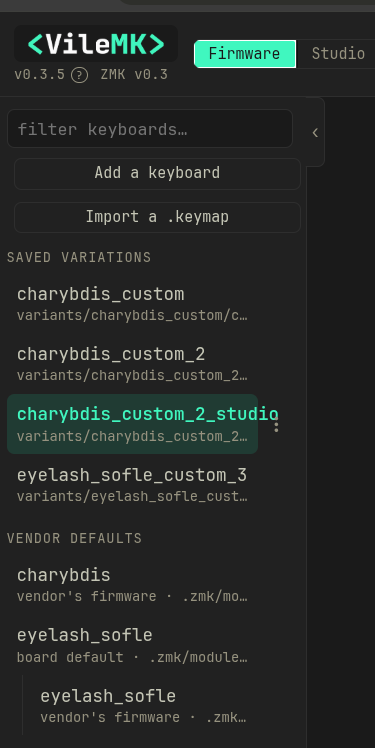

Some keyboards are a shield that plugs into a separate controller board. Then
the dialog asks which controller you have; its name is usually printed on the
board or listed in the shop page (`nice_nano_v2` is the most common).

If your keyboard is not in the list and you do not know its GitHub address,
search GitHub for `zmk-<keyboard name>` or look in the maker's documentation
for "ZMK". [TROUBLESHOOTING.md](TROUBLESHOOTING.md) says what a usable
repository looks like.

Some keyboards need more modules than their own, such as a trackball or
encoder driver. When a fetched module's own `config/west.yml` lists modules
this project does not have, the dialog shows them under **Drivers ... uses**,
each with a tick and a branch or tag. They are unticked: at this point VileMK
only knows that the vendor's build fetches them, not which ones your keyboard
uses. You can fetch them here, or leave them for later. The list is gone
once the dialog closes.

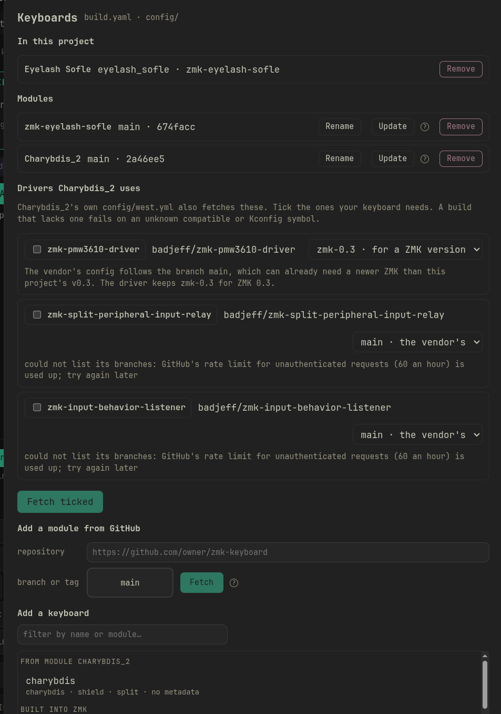

Which ones a build needs shows up when you build a variant (step 5).

### 2. Make a variant

A variant is your own copy of a keymap. Only a variant can be saved over and
built; vendor defaults stay as the maker published them.

Select the vendor default in the sidebar and press **Save as…** in the bar
above the board. It asks for a name and adds the copy under **Saved variations**. You
can also change keys on the vendor default first and then **Save as…**; the
changes go into the new variant.

From then on, select the variant to work on it. Its **Save** button offers
**Overwrite** (save into this variant) or **Save as…** (save a new one).

### 3. Edit your keys

Click a key on the board to open its editor. The tabs under the board then
fill that key:

- **Keyboard**: letters, numbers, symbols, F-keys.
- **Media & system**: volume, mouse, Bluetooth, reset and similar.
- **VileDance**, **Macros**, **Modifiers**, **Layers**: keys that do more than
  one thing, which you design once and then put on keys.
- **Combos** and **Conditional layers**: not keys; you switch them on for
  the keymap.

Picking something puts it on the key straight away. Drag a key onto another
to swap them. The layer tabs above the board switch between layers. Nothing is
written to the variant until you press **Save** (**Overwrite**).

[Keymapping](#keymapping) below covers the board in detail, and
[KEYMAP.md](KEYMAP.md) explains every tab.

### 4. Optional: prepare for Studio mode

[Studio mode](STUDIO.md) changes keys on a plugged-in keyboard without a
build. The firmware has to be built for it, so decide before you build. Skip
this step if you will only use Firmware mode.

1. Put a `&studio_unlock` key somewhere in the variant (**Media & system**
   tab, **Power and firmware** group) and save. A keymap with that key is
   built with ZMK Studio switched on; without it Studio mode cannot talk to
   the keyboard at all. Pressing the key on the keyboard later unlocks it for
   editing.
2. Optional, for VileDances and combos in Studio: vile slots. Studio can only
   put on a key what the firmware already holds; vile slots reserve room so
   it can also place VileDances and combo outputs.
   [STUDIO.md](STUDIO.md#what-vile-slots-are-for) explains them. To add them:
   - In the **Build** panel, tick **include vile slots**. It stays off until
     the keymap has a `&studio_unlock` key.
   - **Edit slots…** opens the split. Each row says how many slots one of
     that kind takes and how many the variant already has; the line under
     them counts slots used and left. Set how many four-way VileDances and
     two-way VileDances to make room for. Combo outputs are not set here: every
     combo that is On or Reserved gets one slot, and if they leave too little
     room the build lowers the four-way count first, then the two-way one. Also
     set the **Tapping term (ms)** (how long a
     key must be held to count as a hold), and the **First press flavor** and
     **Second press flavor** (how a press decides between tap and hold; the
     **?** in the dialog explains each one).
   - **Defaults** fills in a split for the keyboard's size; **Use these**
     keeps it for the build. To change the split later, edit it and build
     again.

   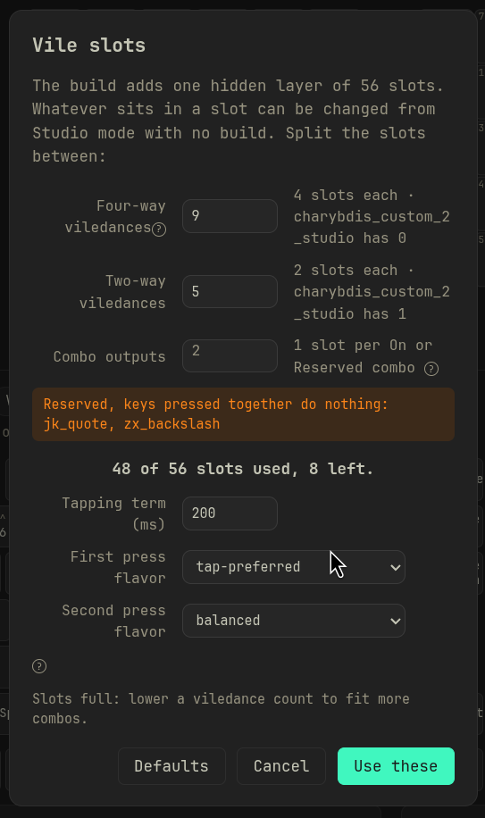

### 5. Build

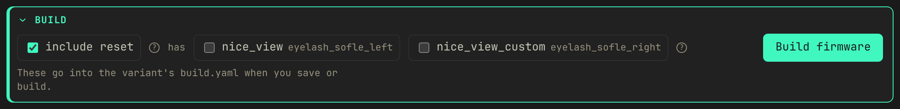

The **Build** panel under the Save button holds the build options for the
variant on screen:

- **include vile slots** reserves room for VileDances and combos you can
  then change from Studio mode without a build. Set in
  [step 4](#4-optional-prepare-for-studio-mode).
- **include reset** also builds a settings reset file for each half. Tick it
  if the keyboard has ever been used with ZMK Studio: keys saved from Studio
  override new firmware until they are cleared. It is ticked by default when
  the keymap has a `&studio_unlock` key. [Step 6](#6-flash) says how to use
  it.
- **has** lists the parts the vendor builds for (screens, add-on modules), per
  half. Tick the ones physically on your keyboard. An unticked screen also
  switches the display off for that half, so the build does not fail looking
  for hardware that is not there.
- **folder** appears when the vendor keeps the keyboard in more than one
  folder, one per way of building it. Charybdis has `charybdis-bt` (the halves
  talk to the computer over Bluetooth) and `charybdis-dongle` (a separate
  dongle does). Pick the one that matches your hardware. Build stays off until
  you do.

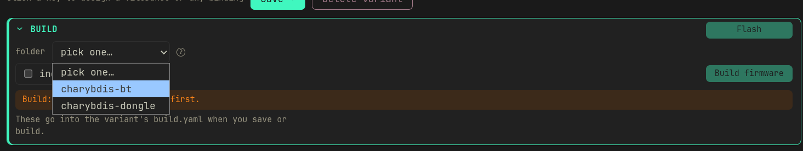

**Build firmware** uses those choices even if you haven't saved, and the
variant remembers them. The build log streams into the dialog, and the build
can be cancelled.

If the modules the variant builds from fetch drivers this project does not
have yet, **Build** lists them in **Add the drivers first**, all ticked, before
it starts. **Fetch and build** adds the ticked ones and builds; **Build
without** builds as is, for a driver the keyboard does not use. See
[Drivers and other dependencies](TROUBLESHOOTING.md#drivers-and-other-dependencies).

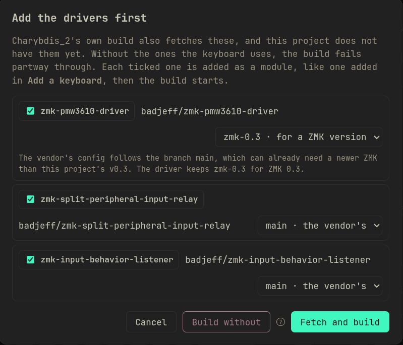

The first build pulls ZMK's build image (about 3 GB) and fetches ZMK, Zephyr
and the hardware libraries. That takes several minutes. A later build of a
split keyboard takes about 20 seconds.

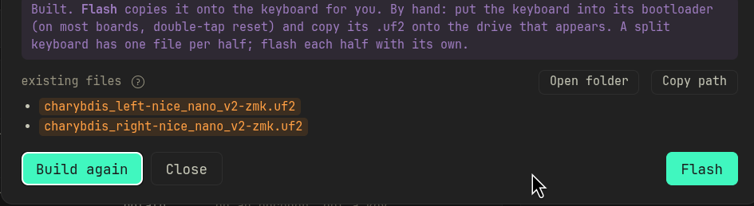

When it finishes, the dialog lists the files it wrote. **Open folder** opens
the firmware folder in your file manager and **Copy path** copies its location.
Before a build, the same list shows what is already there: files the next
build replaces are in orange, files it will remove are struck out. **Flash**
in the corner goes straight to step 6.


### 6. Flash

Flashing copies the built firmware onto the keyboard. Do it from the app:
**Flash** on the Build banner, or **Flash firmware** in the variant's **⋮**
menu in the sidebar. Both are off, with the reason, while the variant has
unsaved changes or changed since its last build.

The Flash sheet lists the variant's firmware files and walks you through it:

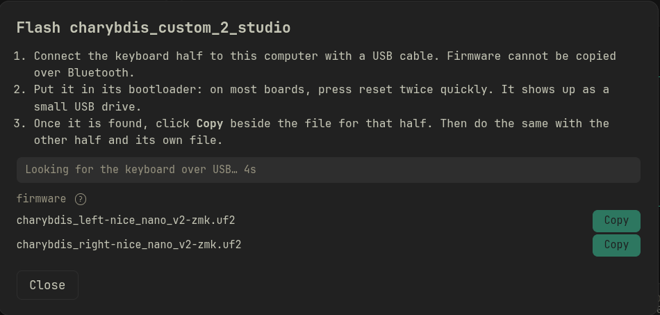

1. Connect the keyboard (on a split keyboard, one half) with a USB data
   cable. Firmware cannot be copied over Bluetooth.
2. Put it in its bootloader: on most boards, press its reset button twice
   quickly. It shows up as a small USB drive, and the sheet finds it.
3. Click **Copy** beside the file for that half. The sheet waits until the
   drive disappears and says **Flashed**.
4. On a split keyboard, do the same with the other half and its own file
   (`…_left…` on the left half, `…_right…` on the right).

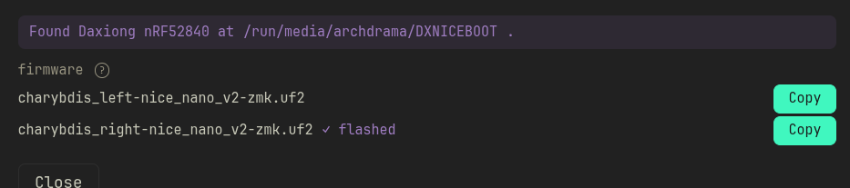

When the copy finishes and the drive disappears, the sheet confirms it:

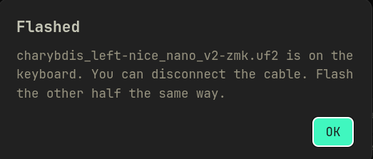

If the sheet says **Keyboard not found**, the keyboard is not in its
bootloader yet. Press reset twice quickly again, or press the half's
`&bootloader` key if the keymap has one, then click **Look again**.

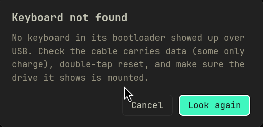

A board that produces a `.bin` instead of a `.uf2` has no drive to copy to;
flash it with the board's own tool.

> [!WARNING]
> **If the keyboard has ever been used with ZMK Studio**, clear its stored keys
> before or right after flashing. ZMK Studio saves the keys you change in it
> to the keyboard's settings storage, and on every boot those saved keys
> override the keymap in the firmware, for those positions only. Flashing new
> firmware does not clear them and neither does the reset button. The symptom
> is a keyboard that runs your new keymap except for a few keys that do
> something else or nothing.
>
> Two ways to clear them:
>
> - **The keyboard still connects in Studio mode:** use **Reset to flashed
>   firmware** there ([STUDIO.md](STUDIO.md#reset-to-flashed-firmware)). No
>   extra firmware, and Bluetooth pairings stay.
> - **Otherwise:** build with **include reset** ticked (step 5). In the Flash
>   sheet, copy the `settings_reset…` file to each half first; the sheet then
>   tells you to put that half in its bootloader again and copy its firmware.
>   Pair Bluetooth again afterwards: this reset clears the pairings too.

## Keymapping

### Behaviours: every tab in the app

Under the board is a menu of eight tabs: **Keyboard**, **Media & system**,
**VileDance**, **Macros**, **Modifiers**, **Layers**, **Combos** and
**Conditional layers**.

Click a key on the board to open its editor. Whichever tab you're on, picking
something fills that key. The tabs' **+ New …** buttons open a creation panel
above the menu instead, and the menu then fills whichever field in that panel
you last clicked. Only one thing is ever open at once, a key editor or a panel,
but switching loses nothing you typed: each kind keeps its own unsaved draft,
and the tab you left grows a **Resume …** button until you finish it or start a
fresh one.

Six of the eight tabs fill a field this way. **Combos** and **Conditional
layers** don't, because nothing on the board can point at either one. You
switch those on or off for the keymap you're looking at.

The **key positions** checkbox under the layer tabs numbers every key on the
board. **+ layer** beside the layer tabs adds a layer, up to ZMK's own 32-layer
cap. **Empty layer** asks for a name and starts the layer blank (every key
transparent). **Layer from another keyboard…** copies a layer from one of your
saved variations, on any keyboard: search for the variation, pick the layer,
and **Import**. Nothing is written until you save.

A copied layer is matched to this keyboard by key position number: key 0 goes
on key 0, key 1 on key 1, and so on. Each keyboard numbers its keys by its own
layout, so turn on key positions to see where a key lands. On a keyboard with
more keys the extra keys stay transparent. On one with fewer, the bindings past
its last key are left out, and the dialog lists them before you import. The
VileDances, macros and layer entries the layer uses come along when you save.
Layer keys keep their numbers: `&mo 2` switches to layer 2 of the keymap you
are editing.

Rotary encoders are not editable in the app yet. Saving a variant keeps the
encoder bindings the keymap already had, and `make check` still validates them.
To change one, edit the keymap file by hand.

Each tab and its settings are described in [KEYMAP.md](KEYMAP.md):
[Keyboard](KEYMAP.md#keyboard),
[Media & system](KEYMAP.md#media--system),
[VileDance](KEYMAP.md#viledance-vial-style-tap-dances),
[Macros](KEYMAP.md#macros),
[Modifiers](KEYMAP.md#modifiers),
[Layers](KEYMAP.md#layers) and
[Combos and Conditional layers](KEYMAP.md#combos-and-conditional-layers).

### Saving

Everything you design in the tabs is saved as you work, independent of any
keymap. Nothing reaches a keymap until you save a variant. Only the generated
behaviors your keys, VileDances and combos actually reference are written into
it; anything designed but never bound stays out.

### Sharing a layout

Sharing means sharing the `.keymap`. **Export keymap** in a row's **⋮** menu
works for variations and vendor defaults. It offers **Save as…** (pick where to
write the file) or **Copy to clipboard**, and **include key positions** adds a
comment at the top of the file drawing the layout with each key's position
number. The exported file carries one extra comment line listing the
VileDances, macros, combos and layer entries the keymap uses, which is what
lets VileMK restore them on import. The compiler ignores it.

**Import a .keymap** in the sidebar takes one back, or you can drop the file on
the sidebar. It refuses a keymap for a keyboard you have not added, since
without the physical layout there is nothing to draw, and tells you which
module to add. Where an incoming record has the same name as one of yours but
different contents, it asks: rename the incoming one (every reference in the
keymap is rewritten to match) or keep yours. Your own records are never
overwritten. What it writes is a new variant, and it runs the same checks
`make check` does before handing it back.

**Export as picture**, in the same menu, has **Copy image**, **Save PNG** and
**Save SVG**, for pasting a layout into a chat.

## Building firmware in detail

**Build firmware** compiles every half of the variant, plus the settings reset
files if **include reset** is ticked. The firmware folder is replaced only when
everything built; a failed or cancelled build leaves the previous files. A
variant whose keyboard is not installed (its module was removed, or the keymap
came from someone else) is refused before Docker starts, with a message naming
the missing board.

The build runs in `zmkfirmware/zmk-build-arm:stable`, the image ZMK's own build
workflow uses. The ZMK and Zephyr sources it fetches on the first build are
kept in a Docker volume, `vilemk-zmk`, and reused by later builds. To free the
space:

```bash
docker volume rm vilemk-zmk
```

The next build fetches them again.

### Repositories built by their maker's own CI

Some keyboard repositories only build through their maker's GitHub workflow,
which deletes or copies files first. VileMK recognises the usual steps and
builds from a prepared copy under `.zmk/stage/`, leaving `.zmk/modules/` as
fetched. Where the repository offers more than one way to build, you pick:

- **folder**: shown in the Build panel when the repository keeps the keyboard
  in several folders (for example Bluetooth and dongle). Build stays off until
  one is picked.
- **builds**: the maker's own build entries, to tick. Build stays off when
  none is ticked, or when one half is ticked twice.
- **vendor settings**: in the build sheet, the maker's `config/*.conf` files,
  ticked the way the maker's build applies them.

The drivers such a repository pulls in are listed after fetching it, in the
keyboards sheet, and again by **Build** for any still missing (see step 1). [TROUBLESHOOTING.md](TROUBLESHOOTING.md#repositories-vilemk-prepares)
has the details and a Charybdis example.

### Parts the vendor lists

Most keyboards are more than a board. A screen, an encoder or an add-on module
is a separate part the build has to be told about, on the half it is plugged
into. The vendor writes one build list for every version they sell, with a
screen and without, so it cannot say which one is on your desk. That is what
the Build panel's **has** boxes are for.

An unticked screen switches the display off for that half, because a vendor
building for the version with a screen often turns the display on for
everyone, and the build then fails looking for hardware that is not there. To
switch a feature off for a half yourself, put the setting in that half's
`.conf` file in `config/`, named after the board (for an Eyelash Sofle's left
half, `config/eyelash_sofle_left.conf`):

```
CONFIG_ZMK_DISPLAY=n
```

It is added on top of the vendor's settings, and nothing VileMK fetches ever
overwrites it.
