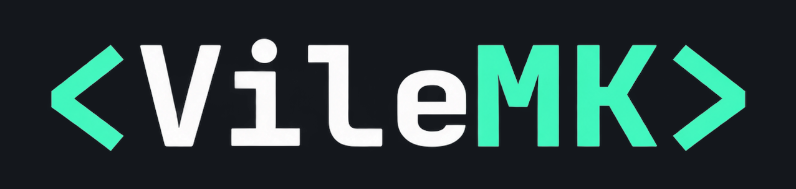
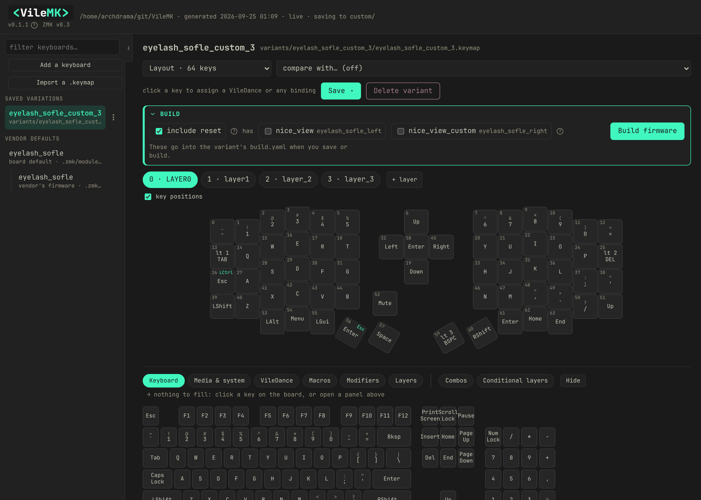
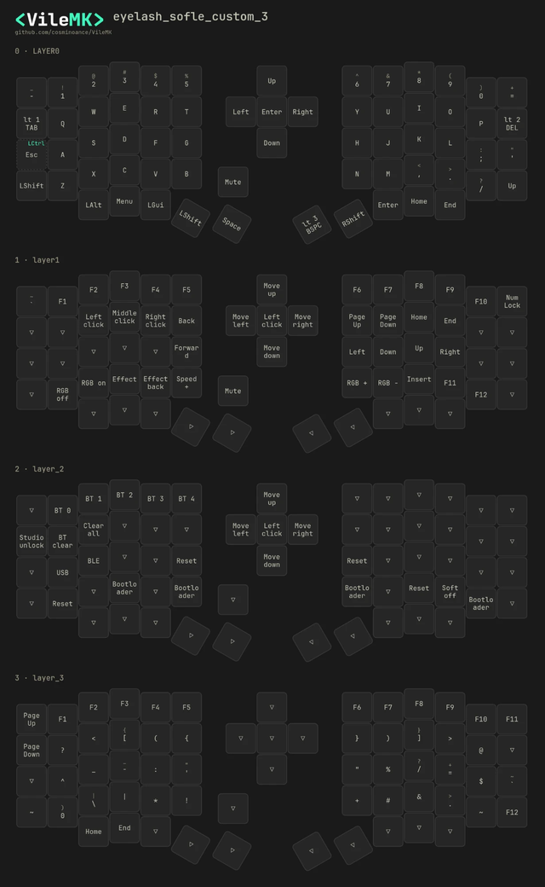

<p align="center">
  
</p>

VileMK is a keymap editor for keyboards that run [ZMK](https://zmk.dev), the
open-source firmware used by most wireless split keyboards. You change what
each key does in a web page on your own computer, then either flash new
firmware or edit the keyboard live over USB. Nothing is uploaded anywhere.

The name is a nod to [Vial](https://get.vial.today/), the graphical keymap
editor from the QMK world that inspired this project. Vial is a potion bottle;
VileMK is vile, as in ruthless.



## VileDance: Vial's tap dance for ZMK

One key, up to four outputs, depending on how you hit it:

| Gesture | Example |
|---|---|
| Tap | `A` |
| Hold | Left Shift, or a layer while held |
| Double tap | Caps Lock, or a macro that types your email |
| Double tap, then hold | Left Ctrl |

ZMK has no such key. Getting a hold and a double tap out of one key means writing a
hold-tap nested inside a tap-dance in devicetree by hand. VileMK builds that for you from four
fields, with the tapping term and flavor in the same panel. A saved VileDance can be bound to as
many keys as you like, and editing it changes all of them.

It also works without a build. With a **vile slots** firmware flashed once, Studio mode creates,
edits and moves VileDances on the plugged-in keyboard live, which ZMK Studio cannot do on its
own. See [the VileDance tab](KEYMAP.md#viledance-vial-style-tap-dances) and
[what vile slots are for](STUDIO.md#what-vile-slots-are-for).

## The nice parts

- **Drag a key onto another** to swap them, in both modes. Layers can be added, renamed, moved
  and deleted too.
- **Export the keymap as a picture**: copy it to the clipboard or save a PNG or SVG, ready to
  paste into a chat or a forum post.
- **Export the keymap as a `.keymap` file**, optionally with a drawing of the layout and each key's
  position number in a comment at the top. Drop a `.keymap` file on the sidebar to import one.
- **Import a layer from another keyboard**, leaving out the keys you choose.
- **Compare** two keymaps, or the keyboard against its keymap file.
- **Save the keyboard's live state** from Studio mode as a variant, and keep the keymap your
  keyboard came with untouched.
- **Combos, macros, hold-taps, mod-morphs and conditional layers** next to VileDances, with a
  picker for each.
- **Build firmware and flash it** from the app, with a warning before flashing firmware that
  differs from what is on the keyboard.

<p align="center">
  
</p>

## Two modes

The switch at the top of the page picks one.

| | Firmware mode | Studio mode |
|---|---|---|
| What you edit | A keymap file (a variant) | The keys on a keyboard plugged in over USB |
| When a change works | After a build and a flash | At once |
| What you can add | Everything: combos, macros, VileDances, hold-taps, mod-morphs, conditional layers, layers | Anything already in the firmware, plus VileDances and combos in the vile slots the build set aside |
| What it needs | Docker, to build | A keyboard flashed once from Firmware mode with a `&studio_unlock` key, plugged in over USB (not Bluetooth) |

**Start in Firmware mode** to add your keyboard, make a variant, build and flash it once.
**Then use Studio mode** to try changes on the keyboard straight away. **Save as variant…** turns
the live state back into a keymap file, so the next build has it too.

- [Firmware mode](FIRMWARE.md): add a keyboard, make a variant, build and flash.
- [Studio mode](STUDIO.md): prepare the firmware once, then connect and edit live.
- [The keymap tabs](KEYMAP.md): every behavior the app can edit.

## Getting started

You need Python 3.9+, Node.js 20.19+, Docker (to build firmware) and git, plus a USB data cable.
On Linux and macOS:

```bash
git clone https://github.com/cosminoance/VileMK.git
```

```bash
cd VileMK
```

```bash
make design
```

On Windows, put the folder somewhere short such as `C:\VileMK` and double-click `start.bat`.

The page opens in your browser by itself; if it does not, open `http://127.0.0.1:7879`.
Leave the terminal running while you use the app; Ctrl+C stops it.

[INSTALL.md](INSTALL.md) has the install steps per system, including Docker. Then continue
with [Firmware mode](FIRMWARE.md), step 1. Video walkthroughs:
[VileMK on YouTube](https://www.youtube.com/playlist?list=PLAOzGtpkRAZg).

## More

- [Troubleshooting](TROUBLESHOOTING.md): flashing problems, Studio mode not finding a keyboard, build errors, missing drivers.
- [Command line and keyboard list details](CLI.md)

<details>
<summary>VileMK compared with ZMK Studio</summary>

| Feature | VileMK | ZMK Studio |
| --- | --- | --- |
| Edit keys live over USB, no flash | Yes | Yes |
| Add, delete, rename and move layers live | Yes | Yes |
| Use behaviors already in the firmware | Yes | Yes |
| Runs with no install (web or desktop app) | No, runs locally with Python and Docker | Yes |
| Keyboard picker: every keyboard in ZMK and installed modules, or a module fetched from GitHub | Yes | No, edits only the keyboard plugged in |
| Edit the keymap file itself (variants, vendor defaults kept untouched) | Yes | No |
| Create combos, macros, VileDances (tap dances), hold-taps, mod-morphs, conditional layers | Yes, then build and flash | No |
| Create and edit VileDances live | Yes, after a one-time flash of a vile slots build from VileMK | No |
| Switch combos on and off and change their outputs live | Yes, after a one-time flash of a vile slots build from VileMK | No |
| Pickers for keys, behaviors, combos and VileDances | Yes | Keys and behaviors only |
| Saved combos and VileDances, reused across keymaps | Yes | No |
| Import a layer from another keyboard, leaving out chosen keys | Yes | No |
| Import a `.keymap` file from another config | Yes | No |
| Drag a key onto another to swap them | Yes | No |
| Compare with another keymap, or the keyboard with its keymap file | Yes | No |
| Save the keyboard's live state as a keymap variant | Yes | No |
| Build firmware and flash it from the app | Yes | No |
| Warn before flashing firmware that differs from the keyboard | Yes | No |
| Export the keymap as a picture or a `.keymap` file | Yes | No |

</details>

## Words used here

<details>
<summary>New to ZMK? Open for the words this guide uses.</summary>

| Word | Meaning |
|---|---|
| **Firmware** | The program that runs inside the keyboard. It decides what each key sends. |
| **Keymap** | The part of the firmware that says which key does what, layer by layer. In ZMK it is a `.keymap` text file. |
| **Layer** | A full set of key meanings. Holding a layer key switches the whole board to another layer, the way Shift switches letters to capitals. |
| **Build** | Turning a keymap into a firmware file (`.uf2`). VileMK does this on your computer with Docker. |
| **Flash** | Copying that firmware file onto the keyboard. The keyboard shows up as a USB drive and you copy the file onto it. |
| **Vendor default** | The keymap your keyboard came with, as its maker published it. VileMK never changes it. |
| **Variant** | Your own copy of a keymap, which you edit, build and flash. |
| **Module** | A keyboard maker's GitHub repository with the files ZMK needs for their keyboard. VileMK fetches it when you add the keyboard. |
| **ZMK Studio** | A feature of ZMK that lets a program change keys on a plugged-in keyboard without a build. VileMK's Studio mode uses it. |
| **Split keyboard** | A keyboard in two halves. Each half has its own firmware file and is flashed on its own. |
| **Bootloader** | A mode the keyboard starts in to receive new firmware, usually by pressing its reset button twice quickly. It then shows up as a USB drive. |
| **Combo** | Two or more keys pressed together that send something else. |
| **VileDance** | One key that does different things on a tap, a hold, a double tap, or a tap then hold. |
| **Vile slots** | Room the build sets aside so Studio mode can add VileDances and combos without another build. |

</details>
