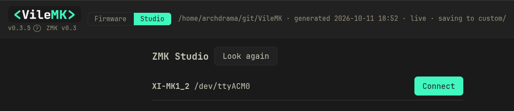

# Studio mode

[← back to the README](README.md)

Studio mode edits the keys on a connected keyboard over USB, with no build.
Each change works on the keyboard as soon as you make it.

The keyboard has to be in the app first: added through **Add a keyboard**,
either from a module fetched from GitHub or one of the keyboards ZMK ships (see
[Firmware mode, step 1](FIRMWARE.md#1-add-your-keyboard)). Studio pairs the
connected keyboard with one of its keymaps, a vendor default under **Vendor
defaults** or one of your saved variations, to name its keys and to save
changes back as a variant.

## What vile slots are for

ZMK Studio can only put on a key what the firmware already contains: plain
keys, layer keys, media keys and the like. A VileDance or a combo is compiled
into the firmware, so a new one normally needs a build and a flash.

Vile slots get around that. The build reserves one hidden layer of empty
slots, as many as the keyboard has keys (56 on a Charybdis). Studio mode
writes a VileDance or a combo output into free slots, and from then on it can
be changed, moved or removed from Studio with no build.

| Kind | Slots each | Holds |
|---|---|---|
| Four-way VileDance | 4 | A VileDance with a second press: a double tap or a tap then hold |
| Two-way VileDance | 2 | A VileDance with a tap and a hold and no second press |
| Combo output | 1 | What a combo sends |

Combos work differently from VileDances. A combo's keys, timeout and layers
are compiled into the firmware, so adding a combo or changing its keys always
needs a build. The build gives one slot to every combo that is **On** or
**Reserved** for the variant, so there are no spare combo slots. In Studio mode
you can then:

- change an On combo's output;
- switch a combo between On and Reserved. Reserved writes `&none` into its
  slot: pressing its keys together does nothing and they do not type.

To have a combo you can turn on later from Studio, set it to **Reserved** in
Firmware mode before you build. If the slots are full, lower the four-way or
two-way VileDance count in **Edit slots…** to make room.

All the slots on one keyboard share one timing: the tapping term and the two
flavors set in **Edit slots…**. A VileDance with its own timing uses the
shared one once it sits in a slot, and the dialog lists any that differ.

A VileDance that does not fit in the free slots still works: it stays compiled
into the firmware as before, and changing it needs a build. When every slot of
a kind is in use, Studio says so; free one by unbinding a slot VileDance, or
build again with more of that kind.

Without vile slots Studio mode still works for everything else.

## 1. Prepare the firmware

Studio mode only talks to a keyboard whose firmware was built for it: the
variant needs a `&studio_unlock` key, and vile slots if you want them, before
it is built and flashed. The steps are in
[Firmware mode, step 4](FIRMWARE.md#4-optional-prepare-for-studio-mode).

## 2. Connect and edit

Studio works over USB only, not Bluetooth.

1. Switch to **Studio** with the **Firmware / Studio** switch beside the logo.
2. Plug in the part of the keyboard that connects to the computer: the left
   half of a split keyboard, or the dongle if you use one. The build turns
   Studio on there. Studio lists the keyboard by name and port; **Look
   again** refreshes the list. If it never appears, see
   [TROUBLESHOOTING.md](TROUBLESHOOTING.md#studio-mode).

   

3. Press **Connect**. The first time, the app asks which keymap the keyboard
   runs: pick the variant you last flashed to it. The app uses it to name the
   keys, to show what differs from the file, and as the base for **Save as
   variant…**. You can change it later from the **keymap** select.
4. Press the `&studio_unlock` key on the keyboard. Until then the page says
   the keyboard is locked and keys cannot be changed.
5. Change keys as in Firmware mode: click a key, pick from the tabs, or drag
   one key onto another to swap them. Each change goes to the keyboard at once
   and works straight away, but the keyboard only holds it in memory.
   Studio cannot add combos (unless the keyboard has vile slots) or
   conditional layers; those tabs are dimmed. **+ layer** turns on a layer
   the firmware reserved, and is off when there is none left.
6. **Save to keyboard** writes the changes to the keyboard's storage, so they
   survive a power-off. **Discard** drops them and goes back to the last save.

## 3. Keep the changes in a variant

Keys saved to the keyboard live only on that keyboard. **Save as variant…**
copies its keys, layer names and layer order into a new variant of the keymap
it runs, so a build holds them too. It always creates a new variant and never
changes an existing one, and the keyboard is matched to the new variant from
then on.

The button is off until it can work; hover over it for the reason. The usual
ones: the keyboard has unsaved changes (**Save to keyboard** first), or the
keymap file has a different number of layers than the keyboard (it is not the
file the keyboard was flashed with).

The new variant appears under **Saved variations** in Firmware mode. Build and
flash it there when you want the firmware itself to match.

## Reset to flashed firmware

**Reset to flashed firmware** erases every Studio change stored on the
keyboard, keys, layer names, layer order and added layers, and goes back to
the keymap it was flashed with. Bluetooth pairings stay and nothing is
flashed. Use it before flashing a new variant onto a keyboard that has Studio
changes stored (see the warning in
[Firmware mode, step 6](FIRMWARE.md#6-flash)). When the keyboard differs
from its keymap file, it offers **Save as variant first**.
