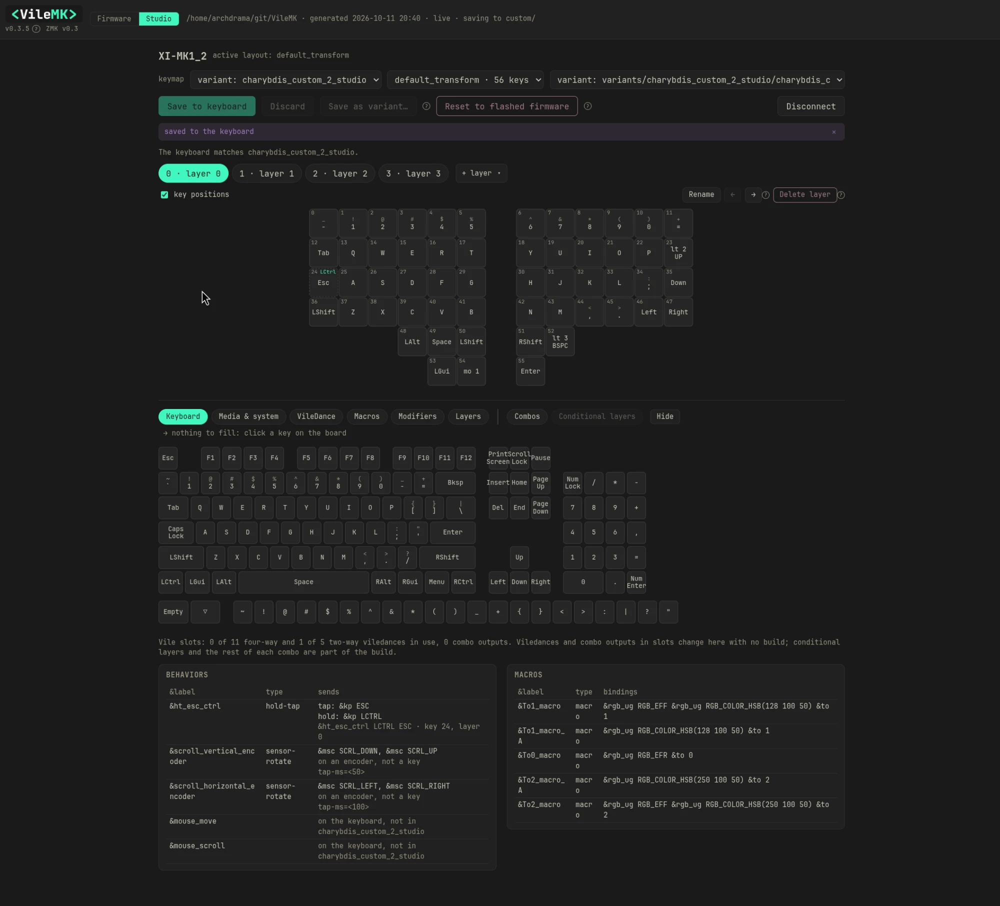

# 0.4.0

- **Studio mode** is new in this version. It edits a keyboard connected over USB through ZMK Studio, and each change takes effect on the keyboard without a build or a flash. It covers keys, layers (add, delete, rename, move) and behaviors already in the firmware; with a vile slots build it also creates and edits VileDances and switches combos. **Save as variant…** writes the keyboard's state back to a keymap for the next build.
- The header has a Firmware / Studio switch. Firmware is the editor you know. Studio edits a keyboard connected over USB through ZMK Studio, with no build or flash.
- Studio mode lists the keyboards that answer, connects to one and shows its layers on the board, and says when the keyboard is locked or holds unsaved changes.
- Studio mode edits the keyboard with the same board, key editor and menu as Firmware mode, including drag to swap: each change goes to the keyboard straight away and is marked on the board until you **Save to keyboard** or **Discard**.
- In Studio mode, anything the keyboard's firmware does not have (a macro or VileDance that was never built, combos, conditional layers) is greyed out, and hovering says to build and flash it first.
- Studio mode asks to save or discard before you leave it or disconnect with unsaved changes. While the keyboard is locked, keys cannot be clicked until you press its `&studio_unlock` key.
- Studio mode asks once which of your keymaps a keyboard runs, draws the board in that keymap's layouts and compares the keyboard with it. Change it from the keymap select above the board.
- Studio mode adds and deletes layers on the keyboard. A new layer needs a reserved layer in the firmware; when none is left, **+ layer** says so.
- Studio mode shows the keyboard's own behaviors (macros, hold-taps, VileDances) in the tables under the board, with what your matched keymap says each one does.
- Layers can be renamed and moved with **Rename** and the arrow buttons next to **Delete layer**, in Studio mode straight on the keyboard and in Firmware mode when you save. A move renumbers the keys, combos and conditional layers that name layers by number.
- In Studio mode, a drag-to-swap the keyboard refuses halfway is undone instead of leaving one key changed.
- Studio mode says how the keyboard differs from its matched keymap (keys, layers added, removed, renamed or moved, behaviors the file lacks) and counts the changed keys on each layer tab.
- Fixed: in Firmware mode, saving a keymap that has a reserved layer before other layers, or adding layers to one with reserved layers, could put edits on the wrong layer.
- **Save as variant…** in Studio mode is refused when the keymap has changed since the keyboard was flashed (a different layer count, or saved after its last build), and says why.
- **Save as variant…** in Studio mode saves the keyboard's keys, layer names and layer order as a new variant of the keymap it runs. Existing keymaps are never overwritten from Studio mode.
- **Reset to flashed firmware** in Studio mode erases the changes Studio stored on the keyboard. Bluetooth pairings stay and nothing needs flashing.
- The flash sheet warns when the keyboard open in Studio mode differs from the variant being flashed, since Studio's keys would win over the new firmware, and offers to reset it.
- **include vile slots** in the Build panel adds a hidden layer of slots to the firmware, set up with **Edit slots…**: how many four-way and two-way VileDances it holds, and the timing they share. It needs a key bound to `&studio_unlock`.
- On a keyboard flashed with vile slots, Studio mode creates and edits VileDances and changes combo outputs straight on the keyboard, with no build. The VileDance and Combo panels open in Studio mode, and their Save updates the keyboard as well as your saved VileDance or combo.
- Combos have a third state next to On and Off: **Reserved**. On a variant built with vile slots, a Reserved combo is in the firmware but switched off, and Studio mode can switch it on and off with no build. While it is off, its keys pressed together do nothing. A combo the flashed firmware does not have shows **Not built** in Studio mode instead of its On or Off setting.
- A vile slots build gives one slot to every combo that is On or Reserved, so **Edit slots…** no longer asks for a combo count. When the combos need more room, the four-way VileDance count is lowered first, then the two-way one.
- On a keyboard without vile slots, those controls are greyed out, and hovering says how to add them.
- Fixed: a variant saved from Studio mode with an external power key (`&ext_power`) failed to build, because the key was written with names ZMK does not have. It is now written as `EP_ON`, `EP_OFF` or `EP_TOG`.
- Fixed: firmware with vile slots failed to build the half of a split keyboard that is not the central one.

